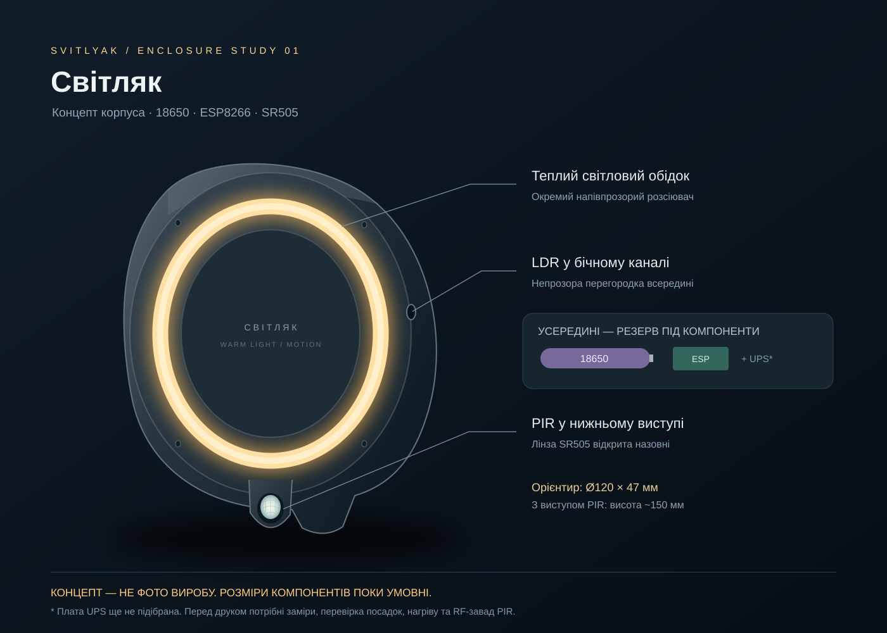

# Svitlyak

**An ESP8266 Wi-Fi night light with motion detection, adaptive brightness, and a Ukrainian-language web interface.**

A 24-pixel LED ring provides warm light while the PIR output is active, then fades after a configurable timeout. Optional integrations enable operation based on Ukrainian power-outage schedules and visual air-raid notifications.

> **Status: experimental hardware prototype, not a production-ready product.** Wi-Fi-related false triggers have been observed with the SR505 sensor used in testing. A hardware fix has not yet been validated. This is not a security system or a replacement for official emergency alerts.



*Concept illustration, not a photograph of an assembled device. Component clearances still require measurements and validation.*

## Features

- Motion-activated lighting in the dark, or continuous nighttime lighting.
- LDR-based adaptive brightness and day/night detection, including while the lamp is on.
- Configurable hold time and a smooth color fade after motion stops.
- Ukrainian web interface, first-run setup wizard, and settings stored in EEPROM.
- Initial Wi-Fi setup through an access point; subsequent access over your home network and mDNS.
- Optional Ukrainian power-outage schedules from public sources, without a personal API key.
- Optional NEPTUN air-raid notifications using LED colors and a vibration motor.
- Live PIR diagnostics, a RAM log of the last 32 completed HIGH runs, Serial output, and a radio-off test.
- Parametric OpenSCAD enclosure concept with space reserved for an 18650 holder.

## Hardware

| Component | Prototype configuration |
|---|---|
| Controller | ESP8266: Wemos D1 mini or NodeMCU |
| Lighting | WS2812-compatible RGB ring, 24 pixels, 5 V supply |
| Motion sensor | HC-SR505 powered from 5 V; check your module's specifications |
| Ambient light | LDR and a voltage-divider resistor, e.g. 10 kΩ |
| Power supply | Regulated 5 V, approximately 2 A or more depending on the LEDs |
| Optional vibration | Motor, transistor/MOSFET driver, appropriate gate/base resistor, and flyback diode |

At maximum white brightness, 24 pixels can draw approximately 1.4 A depending on the LED type. Allow additional current for the ESP8266 and motor. Do not power the ring through a GPIO or the board's 3V3 output.

## Wiring

| Signal | Board pin | ESP8266 GPIO |
|---|---|---|
| LED ring DATA | D4 | GPIO2 |
| PIR OUT | D5 | GPIO14 |
| Motor driver control | D6 | GPIO12 |
| LDR divider | A0 | ADC |

```text
                        +-- ESP8266 board 5V input
5 V power supply -------+-- LED ring VCC
                        +-- power filter -- SR505 VCC

Common GND -------------+-- ESP / LED ring / SR505 GND

D4 -- level shifter* ------ LED ring DIN
SR505 OUT ----------------- D5
LDR voltage divider ------- A0
```

\* A 74AHCT125-style buffer is recommended for reliable signaling from the 3.3 V GPIO to a 5 V LED ring. Use a common ground. GPIO2 is a boot-strapping pin: the external circuit must not pull it LOW during boot.

**Assembly requirements:**

- **Shield the LDR from the ring's own light.** It should measure the room, not the lamp. Otherwise, the lamp can interpret its own output as daylight, dim itself, or switch off.
- Respect your board's A0 voltage limit. The bare ESP8266 ADC accepts up to 1 V; development boards may include a divider. Never connect A0 to 5 V.
- Only connect the sensor's OUT signal to D5, not its 5 V supply. Check your module's output voltage: ESP8266 GPIOs are not 5 V tolerant.
- Route PIR ground directly back to the supply, rather than through wiring carrying the ring's current.
- A suitably rated 470–1000 µF capacitor near the ring is recommended.
- Never connect the motor directly to a GPIO. Normal light-on vibration is disabled by default.
- Do not join independent 5 V supplies or feed external 5 V while connected to a computer's USB without checking your board's backfeed protection.

## Build and flash

Verified dependencies:

- ESP8266 Arduino core **3.1.2**;
- Adafruit NeoPixel **1.15.1**;
- all other headers are included in the ESP8266 core or standard libraries.

### Arduino IDE

1. Add this Boards Manager URL in the IDE preferences:

   ```text
   https://arduino.esp8266.com/stable/package_esp8266com_index.json
   ```

2. Install **esp8266 by ESP8266 Community**, version 3.1.2.
3. Install **Adafruit NeoPixel**, version 1.15.1, through Library Manager.
4. Place `night_light_fixed.ino` inside a folder named **`night_light_fixed`** and open it.
5. Select your Wemos D1 mini or NodeMCU 1.0 (ESP-12E Module), choose the serial port, and upload.

### Arduino CLI

Clone into `night_light_fixed`: Arduino requires the sketch directory to match the main `.ino` filename.

```powershell
git clone https://github.com/olexanderboychuk/svitlyak.git night_light_fixed
cd night_light_fixed

arduino-cli core update-index --additional-urls https://arduino.esp8266.com/stable/package_esp8266com_index.json
arduino-cli core install esp8266:esp8266@3.1.2 --additional-urls https://arduino.esp8266.com/stable/package_esp8266com_index.json
arduino-cli lib install "Adafruit NeoPixel@1.15.1"

arduino-cli compile --fqbn esp8266:esp8266:d1_mini --output-dir build/d1_mini .
arduino-cli board list
arduino-cli upload --fqbn esp8266:esp8266:d1_mini --port COM3 --input-dir build/d1_mini .
```

Replace `COM3` with your own port. For NodeMCU, use `esp8266:esp8266:nodemcuv2` for both compilation and upload. Firmware artifacts (`.bin`, `.elf`, `.map`) are generated locally and are not tracked in Git.

## First-time setup

1. With no saved Wi-Fi credentials, **`Svitlyak-<id>`** starts after a short initial scan. If a saved home network is unavailable, a recovery AP starts after approximately 30 seconds (plus any channel scan). If Wi-Fi association succeeded, an in-progress DHCP exchange is allowed up to 45 seconds before recovery interrupts it.
2. Connect using the default password **`svitlyak123`**. This is a public setup password, not your home Wi-Fi password. Change `AP_PASSWORD` before building if needed.
3. The AP serves **only Wi-Fi setup**: choose your 2.4 GHz home network from the scanned list and enter its password. Lamp settings and diagnostic routes are not accessible through the AP. An initial scan is cached before the AP opens; reopening the iPhone portal reuses that list for up to two minutes rather than starting another radio scan. Manual refresh uses asynchronous scanning with error/timeout messages.
4. iOS HTTP probes receive the Wi-Fi setup page directly; Android/Windows probes redirect to `http://192.168.4.1/`. Automatic popup behavior depends on the phone and cannot be guaranteed: open that **HTTP** address manually if needed, accept staying connected without internet, and temporarily disable VPN/mobile-data switching if it interferes. HTTPS-only browsing cannot be redirected by the device.
5. After connection, the page displays the lamp's **home-network IP**. The setup AP closes automatically after **8 seconds of successful home-network connection**, even if the phone is still associated. Switch the phone back to your home Wi-Fi and open that address, or `http://svitlyak-<id>.local/` where mDNS is supported. Failed joins leave the AP available. During setup AP transmit power is 17 dBm; normal 8.5 dBm returns when it closes.
6. Select the lighting mode, brightness, and motion hold time, then save.

Home Wi-Fi credentials are entered on the device and stored in EEPROM, not embedded in this repository. Saving verifies both the flash commit result and a readback after reopening EEPROM; failures return an error rather than silently reporting success. Saved credentials are loaded on every boot and are not cleared on network failures or power cycles. Serial output uses **115200 baud**.

For iPhone portal stability, the fallback AP suspends background STA retries while a phone is associated, and disables diagnostic radio scans. A manual join is deferred by 1.2 seconds so the POST response can reach the phone before a possible channel change. A failed join returns to AP-only setup after 20 seconds, or after the DHCP allowance if already associated. When no phone is using the portal, saved Wi-Fi is automatically retried after a 30-second idle interval; the AP no longer abandons saved connections permanently. A phone joining the portal pauses an automatic retry, but not a manual join it explicitly requested. After success the captive window has 8 seconds to display the result before the AP closes. These are firmware-side mitigations, not a guarantee of behavior on every iOS version; physical iPhone testing is still required.

Initial connection and reconnection use 17 dBm transmit power to improve reliability on weaker links; normal 8.5 dBm is restored after obtaining an IP (or closing setup AP). A healthy association waiting for DHCP is not interrupted by the regular retry timer or recovery scans. This does not fix poor coverage or insufficient power: a Wi-Fi setup AP appearing after boot can indicate a failed connection, not lost credentials. Check Serial for `WIFI LOAD`, `WIFI SAVE`, association and IP messages before re-entering a password.

## Lighting behavior

1. Initial activation requires darkness, a confirmed PIR signal, and permission from the optional outage schedule.
2. **While the lamp is ON or fading, every observed HIGH refreshes the hold timer.** RF/stuck flags and the maximum-run filter do not interrupt an already active lamp's hold behavior.
3. After the last HIGH, the lamp stays on for `holdSec`, then fades over `waveMs`. A new HIGH during the fade restores normal lighting.
4. Confirmed daylight switches the lamp off even if PIR remains HIGH. Schedule restrictions and alert notifications have their own priority logic.

A false or stuck HIGH can therefore also keep an active lamp on. This is an explicit trade-off, not a hardware interference fix.

### Defaults

| Setting | Default |
|---|---|
| LED count | 24 |
| Brightness | Minimum 15, maximum 100 out of 255 |
| Day threshold / dark activation threshold | 450 / 390 out of 1023 |
| Day/night hysteresis | 60 units; 2 s confirmation after LDR smoothing |
| Hold after the last HIGH | 10 s |
| Fade duration | 2500 ms |
| Warm-up | 60 s; current code shortens this to 3 s when the reset reason is not `Power on` |
| Initial motion confirmation | 42 of 50 samples at intervals of at least 10 ms; HIGH lasting at least 300 ms |
| Stable LOW before rearming | 500 ms |
| Stuck threshold | 60 s; affects initial activation filtering |
| Post-off cooldown | Up to 25 s with the default profile, scaled by on-time and brightness; minimum 1.5 s |
| Maximum HIGH run | 0, disabled |
| Normal light-on vibration | 0 ms |
| Wi-Fi transmit power | 8.5 dBm |

EEPROM settings can override defaults. When migrating from the older v12 settings format, the firmware resets the PIR profile once while retaining the other settings.

**Keep the maximum HIGH-run setting at 0 for SR505.** Enabling it delays initial activation until HIGH ends and can reject genuine sustained motion. SR505 does not have the H/L jumper or sensitivity adjustments found on SR501.

## Outage schedules and air-raid notifications

Both integrations are optional and disabled by default.

- **Schedules:** enable schedule-based operation, select your region and queue, save, then request an update. A listed source does not guarantee fresh data. See [sources and limitations](docs/outage-sources.md).
- **Air-raid notifications:** select your district and enable NEPTUN polling. The default polling interval is 60 s. Notifications blink yellow/red; all-clear blinks green when enabled. Notification vibration is controlled separately from ordinary light-on vibration.

Schedules are forecasts, not measurements of mains voltage. Network delays, upstream services, and parsing errors can affect behavior. Do not rely on this device as your only source of emergency information.

## PIR diagnostics and the known Wi-Fi issue

| Device endpoint | Purpose |
|---|---|
| `/` | Settings |
| `/live` | LDR, PIR, state, latest transition reason, and reset reason |
| `/pir` | Live graph and browser-log download |
| `/pirdata` | Current readings as JSON |
| `/pirevents` | Last 32 completed HIGH runs in RAM |
| `/wifitest?off=180` | Disable the radio for 180 s, then restore it automatically |

The web interface is unavailable during the radio-off test. Use Serial for continuous observation. RAM logs and event counters reset on reboot. Frequent `/pir` polling itself generates radio traffic. The RTC-based `boots` counter is not a reliable lifetime counter: its value can be invalid after power loss.

### Bench observations

On one SR505 prototype, during tests with no intended motion:

| Conditions | Observation time | New HIGH runs |
|---|---:|---:|
| Laptop USB, Wi-Fi ON, three intervals | Approximately 15 min total | 19 |
| Same device, Wi-Fi OFF, three intervals | 15 min total | 0 |
| Entire lamp powered by an external adapter, Wi-Fi ON | 30 min | 34 |

These results support an association with Wi-Fi activity, but **do not distinguish direct RF pickup from supply/ground interference**. The methods also differed: USB tests captured Serial, while the adapter test fetched the event log over HTTP every two minutes. These observations are not universal SR505 specifications.

The `RF` flag marks a HIGH starting within a tagged network-request window; it is not proof of RF interference. HIGH duration alone also cannot identify the cause.

### Hardware checks

1. Separate the sensor and its wiring from the antenna, LED ring, and high-current wiring.
2. Rule out heating, sunlight, drafts, and movement of the sensor itself.
3. Try the supply filter below. It may reduce supply noise but is not guaranteed to stop direct RF pickup.

```text
5 V --[100 ohm]---+-- SR505 VCC
                 +-- positive lead of 100 uF electrolytic (rated >=10 V)
                 +-- one lead of 100 nF ceramic

GND -------------+-- SR505 GND
                 +-- negative lead of electrolytic
                 +-- other lead of 100 nF ceramic

SR505 OUT ----------- D5
```

The resistor goes only in the PIR supply, not the entire lamp's supply. Place both capacitors after the resistor, close to the sensor. Assemble with power disconnected, verify polarity, and check the resulting VCC voltage. Do not bypass the SR505's onboard regulator without a schematic for your specific module.

## Enclosure and battery plans

- [OpenSCAD model](enclosure/svitlyak.scad) and [assembly notes](enclosure/README.md).
- Approximate body: Ø120 × 47 mm with a lower PIR pod. Ring, board, and holder dimensions are placeholders; there is no fit-verified production STL yet.
- The 18650 space is a mechanical reservation only. A charger/UPS board and its mounting have not been selected.
- One-cell operation requires battery protection, suitable charging, a 5 V boost supply, and power-path/load sharing for simultaneous charging and operation.
- Do not connect a cell directly to 3V3. A TP4056 alone does not provide 5 V or a complete load-sharing power path.

## Logic tests

On Windows with Windows PowerShell:

```powershell
powershell -NoProfile -ExecutionPolicy Bypass -File tests/pir-hold.ps1
```

The test extracts portions of the actual sketch and runs them in a C# harness with hardware calls stubbed out: 24 hold scenarios, first-start RF filtering, day/night transitions in OFF/ON/WAVE, hysteresis, and settling delays. This is a **host-side logic check, not a hardware test**, and does not reproduce the entire firmware loop.

## Security and limitations

- The web interface is intended for trusted local networks: HTTP without authentication. **Do not expose it to the Internet.** Diagnostic endpoints can change device behavior.
- Current HTTPS clients use `setInsecure()`: server certificates are not verified.
- The Sumy parser uses a key derived from the public website client, not a personal API token. The implementation does not verify the GCM authentication tag, so it must not be treated as authenticated data processing.
- Synchronous network requests can delay sensor processing.
- Reduced Wi-Fi transmit power can affect connectivity at longer distances.
- A hardware fix for PIR false triggers and enclosure component fits still require validation.

## Repository layout

```text
night_light_fixed.ino       Main firmware sketch
docs/outage-sources.md      Schedule sources and limitations
enclosure/                 Parametric enclosure concept and illustration
tests/pir-hold.ps1          Host-side logic checks
```

When reporting an issue, include your board and PIR models, dependency versions, power wiring, and a short log. Remove SSIDs, private addresses, passwords, and other personal data before publishing logs.
